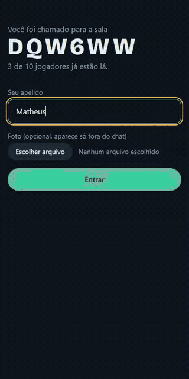
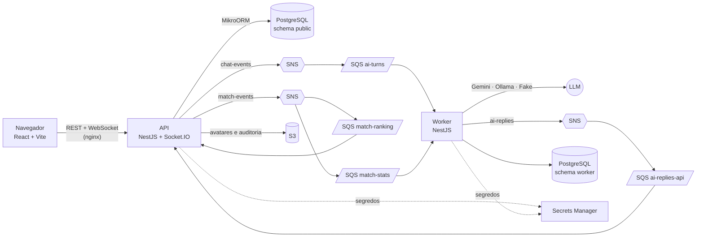

# Quem é a IA?

Jogo multiplayer em tempo real, num chat em grupo com visual de app de mensagens.
Cada amigo entra com um pseudônimo sorteado. Um deles, o Mestre, foi trocado por
uma IA que ele mesmo ensinou a falar como gente. O grupo conversa, vota e descobre
quem era.



> Partida gravada com o `FakeLlmProvider` e três jogadores robôs (`npm run bots`).
> O GIF está acelerado 2,5×.

## Como jogar

1. Alguém cria a sala e toca em **Compartilhar no WhatsApp**. Os amigos entram pelo
   link, no navegador do celular, sem instalar nada.
2. O servidor sorteia **em segredo** o Mestre da IA.
3. **Criação:** o Mestre tem 2 minutos para escrever a personalidade da IA (gírias,
   erros de digitação, opiniões, piadas internas, estratégia). Os outros esperam.
4. **Conversa:** todo mundo aparece com pseudônimo e avatar sorteados. No lugar do
   Mestre, quem fala é a IA. O Mestre só assiste (e pode intervir 3 vezes).
5. **Votação:** cada um vota em qual pseudônimo é a IA.
6. **Revelação:** quem era quem, as mensagens da IA marcadas, o prompt do Mestre e
   os pontos. O ranking da sala acumula entre as partidas.

Mecânicas que o anfitrião liga e desliga na sala: "digitando..." com atraso
realista, limite de mensagens, IA que não responde tudo, número secreto de IAs
(0, 1 ou 2), voto travado, ataques de prompt que valem pontos, intervenções do
Mestre, tema da rodada com pergunta-relâmpago e modo espelho.

**Pontuação:** achar a IA vale +100 (até +50 de bônus se travou o voto cedo);
acusar um humano vale -50; o Mestre ganha +50 por jogador enganado e perde 100 se
a IA sair do personagem.

## Arquitetura



- A **API** é a autoridade: sorteio, prazos das fases, votos e pontuação acontecem
  no servidor. O navegador só mostra a view que recebe.
- Cada mensagem do chat vira um evento no **SNS**. O **worker** consome a fila,
  decide se a IA responde, chama o LLM e devolve a resposta por outro tópico.
- O fim da partida publica `match.finished`, que vai para **duas filas**: o ranking
  (API) e as estatísticas de custo (worker).
- Toda a AWS roda localmente no **LocalStack**, sem conta e sem custo.

Detalhes em [docs/ARQUITETURA.md](docs/ARQUITETURA.md), decisões e problemas reais
em [docs/DECISOES.md](docs/DECISOES.md) e um guia de estudo do código em
[docs/APRENDER.md](docs/APRENDER.md).

## Stack

| Parte | Tecnologia |
| --- | --- |
| API | NestJS 11, TypeScript, Socket.IO (gateway do Nest), class-validator, JWT |
| Banco | PostgreSQL 17 + MikroORM 6 (EntitySchema, migrações) |
| Assíncrono | AWS SNS + SQS (com DLQ), worker separado |
| AWS | S3 (avatares e JSON de auditoria), Secrets Manager, LocalStack 4.14 |
| IA | `LlmProvider` com Gemini (REST), Ollama (modelo aberto local) e Fake |
| Front-end | React 19, Vite 7, Tailwind CSS 4, mobile-first |
| Testes | Jest, Supertest, socket.io-client |
| Infra | Docker, docker compose, nginx, GitHub Actions |

Organização em DDD leve: cada módulo tem `domain` (regras puras, sem framework),
`application` (casos de uso) e `infrastructure` (banco, AWS, LLM, HTTP, WebSocket).

```
apps/api       NestJS: REST, WebSocket, partida, ranking (consome 2 filas)
apps/worker    NestJS: turnos da IA, disjuntor de orçamento, estatísticas
apps/web       React + Vite
packages/shared  contratos: tipos, eventos, configurações, moderação
packages/cloud   SNS/SQS, barramento em memória, Secrets Manager, cifra de chave
load-test      teste de carga e robôs para jogar sozinho
infra          script que cria tópicos, filas, bucket e segredo no LocalStack
legacy         app Flutter original do TCC
```

## Rodar com um comando

Pré-requisito: Docker (com docker compose).

```bash
docker compose up --build
```

Abra **http://localhost:8080**. Sem nenhuma configuração, a IA usa o
`FakeLlmProvider` (respostas prontas e determinísticas), então o jogo funciona sem
chave e sem internet. Para jogar pelo celular na mesma rede Wi-Fi, use o IP do
computador no lugar de `localhost`.

Para jogar sozinho, crie uma sala de demonstração com robôs e entre pelo link que
o comando mostrar (eles começam a partida quando você entra):

```bash
npm install
npm run bots -w @quem/load-test
```

### Com a IA de verdade (Gemini, custo zero)

1. Crie uma chave no [Google AI Studio](https://aistudio.google.com/apikey), num
   projeto **sem faturamento ativado**. Sem faturamento, não existe cobrança: ao
   estourar a cota gratuita, a API só responde erro (e o jogo mostra "A IA está
   descansando"). **Não ative o faturamento nesse projeto.**
2. Confira os limites atuais do nível gratuito na
   [documentação oficial](https://ai.google.dev/gemini-api/docs/rate-limits) e na
   página de limites do AI Studio. Eles mudam com o tempo; por isso não estão
   copiados aqui.
3. Copie `.env.example` para `.env` e preencha `GEMINI_API_KEY`. A chave vai para o
   Secrets Manager do LocalStack e o worker lê de lá. Ela nunca chega ao navegador.
4. `docker compose up --build`.

O modelo padrão é `gemini-2.5-flash-lite` (está no nível gratuito segundo a
[tabela de preços](https://ai.google.dev/gemini-api/docs/pricing)). Dá para trocar
em `GEMINI_MODEL`.

**Privacidade:** no nível gratuito, o Google informa que os dados enviados podem ser
usados para melhorar os produtos dele. O lobby avisa isso aos jogadores.

### Com um modelo aberto local (Ollama)

```bash
LLM_PROVIDER=ollama docker compose --profile ollama up --build
```

O serviço `ollama-pull` baixa o modelo de `OLLAMA_MODEL` (padrão `qwen2.5:1.5b`) na
primeira vez.

## Testes

```bash
npm install
npm test                 # unitários: shared, cloud, api, worker
docker compose up -d postgres
npm run test:e2e         # ponta a ponta: API real + Postgres + Socket.IO
npm run lint
```

Todos os testes usam o `FakeLlmProvider` ou um barramento em memória: nenhum
depende de rede nem gasta cota. Na última execução: 92 testes unitários
(shared 8, cloud 6, api 49, worker 29) e 14 ponta a ponta. A CI
(`.github/workflows/ci.yml`) roda lint, formatação, tipos, testes e o build das
três imagens Docker.

O banco dos testes ponta a ponta é `quem_e_a_ia_test` (criado sozinho se não
existir). Para usar outro, defina `TEST_DATABASE_URL`.

## Variáveis de ambiente

Todas são opcionais; os valores padrão estão em [.env.example](.env.example).

| Variável | Onde | Para que serve |
| --- | --- | --- |
| `GEMINI_API_KEY` | worker (via Secrets Manager) | Chave do Gemini. Sem ela, usa o provedor falso. |
| `LLM_PROVIDER` | worker | `gemini`, `ollama` ou `fake`. |
| `GEMINI_MODEL`, `OLLAMA_MODEL` | worker | Modelo usado. |
| `JWT_SECRET` | api (via Secrets Manager) | Assina o token de cada jogador. |
| `BYOK_ENCRYPTION_KEY` | api e worker (via Secrets Manager) | Cifra a chave própria do Mestre na fila. |
| `AI_MAX_REPLIES_PER_MATCH` | worker | Máximo de respostas de cada IA por partida. |
| `AI_MAX_OUTPUT_TOKENS` | worker | Tamanho máximo de cada resposta. |
| `AI_CONTEXT_MESSAGES` | worker | Quantas mensagens recentes vão no prompt. |
| `AI_DAILY_MAX_CALLS`, `AI_DAILY_MAX_TOKENS` | worker | Disjuntor diário de orçamento. |
| `MAX_MATCHES_PER_ROOM_PER_DAY` | api | Partidas por sala por dia. |
| `RATE_LIMIT_PER_MINUTE` | api | Requisições REST por minuto por IP. |

## Controle de custo de IA

- Chave do servidor só no nível gratuito, num projeto sem faturamento.
- Limites no worker: respostas por partida, tokens por resposta e mensagens de
  contexto. Limites na API: partidas por sala por dia e requisições por IP.
- **Disjuntor diário:** contador de chamadas e tokens no Postgres. Ao passar do
  limite, ou ao receber HTTP 429, a IA para, as salas veem "A IA está descansando,
  voltem mais tarde" e a conversa vai direto para a votação. Coberto por testes no
  worker e no teste ponta a ponta da API.
- **Usar minha própria chave:** o Mestre pode colar a chave dele (só em HTTPS ou
  localhost). Ela é cifrada na hora, fica só na memória durante a partida, nunca vai
  para o banco, para log ou de volta ao navegador, e é descartada na revelação.
- **Métricas:** o worker grava chamadas e tokens por partida e mostra a média em
  `http://localhost:3001/stats`.

**Números medidos até agora (honestos):** só com o `FakeLlmProvider`, em 124
partidas de robôs do teste de carga: média de 7,7 chamadas por partida (partidas de
cerca de 25 s). Os "tokens" do provedor falso são estimativa (caracteres ÷ 4), não
tokens reais. **Ainda não há medição com o Gemini**: depois de jogar com a chave,
consulte `/stats` e atualize esta seção.

## Teste de carga

O script `load-test` abre salas com jogadores robôs que jogam partidas completas
pelo mesmo WebSocket do navegador, passando pelo nginx. Ele mede o tempo até o
servidor confirmar a mensagem (ack) e até ela chegar no navegador de **outro**
jogador (entrega). As salas desligam os atrasos de propósito do jogo, para medir só
o servidor.

```bash
RATE_LIMIT_PER_MINUTE=2000 docker compose up -d
API_URL=http://localhost:8080 ROOMS=50 PLAYERS=5 npm run load-test
```

Resultados reais em 28/10/2026, tudo na mesma máquina (AMD Ryzen 5 5500, 16 GB,
Windows 10, Docker Desktop), uma instância de cada serviço, `FakeLlmProvider`:

| Cenário | Partidas completas | Mensagens humanas | Ack p50 / p95 / p99 | Entrega p50 / p95 / p99 | Erros |
| --- | --- | --- | --- | --- | --- |
| 20 salas × 5 (100 sockets) | 20 de 20 | 480 | 7 / 16 / 48 ms | 9 / 20 / 41 ms | 0 |
| 50 salas × 5 (250 sockets) | 50 de 50 | 1200 | 17 / 97 / 146 ms | 20 / 113 / 185 ms | 0 |

No cenário de 50 salas, o pico de uso foi de cerca de 105% de CPU (um núcleo) e
250 MB de memória na API, e 29% de CPU e 84 MB no worker. A primeira rodada de 50
salas bateu no disjuntor diário (400 chamadas): todas as partidas terminaram de
forma limpa na votação. O resultado acima é da segunda rodada, com o limite diário
aumentado só para o teste (veja "Problemas encontrados" em DECISOES.md).

## A história do projeto

Este repositório começou como o **AvatarGenius**, o app de avatares do meu TCC: um
app Flutter que tirava uma selfie, pedia ao Gemini uma descrição da pessoa, gerava
um avatar com o DALL-E 3 e criava um chatbot com a personalidade do avatar. Ele
tinha problemas que eu aprendi a enxergar depois: chaves de API empacotadas no APK,
dados só no aparelho, nenhum teste.

"Quem é a IA?" pega a ideia que mais divertia no TCC (dar personalidade a uma IA) e
transforma num jogo social com backend de verdade: servidor autoritativo, eventos,
filas, testes e segredos fora do cliente. O app original continua em
[legacy/avatargenius-flutter](legacy/avatargenius-flutter), com o histórico do Git
preservado.

## Próximos passos

- Adapter Redis para o Socket.IO e lock distribuído, para rodar várias instâncias
  da API (hoje timers, presença e lock da sala ficam na memória de um processo).
- Padrão outbox para os eventos: hoje o evento é publicado depois do commit e pode
  se perder se o SNS cair nesse instante.
- Medir custo real com o Gemini e publicar a média aqui.
- Moderação pelo endpoint do provedor, além da lista de bloqueio.
- Infraestrutura como código (Terraform ou CDK) para subir na AWS de verdade, com
  TLS na frente do nginx.
- Testes de componente no front-end.
