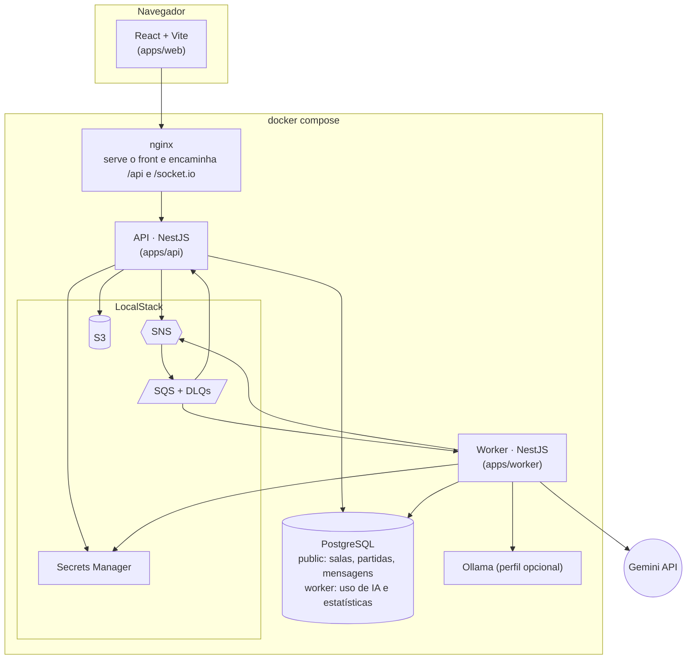
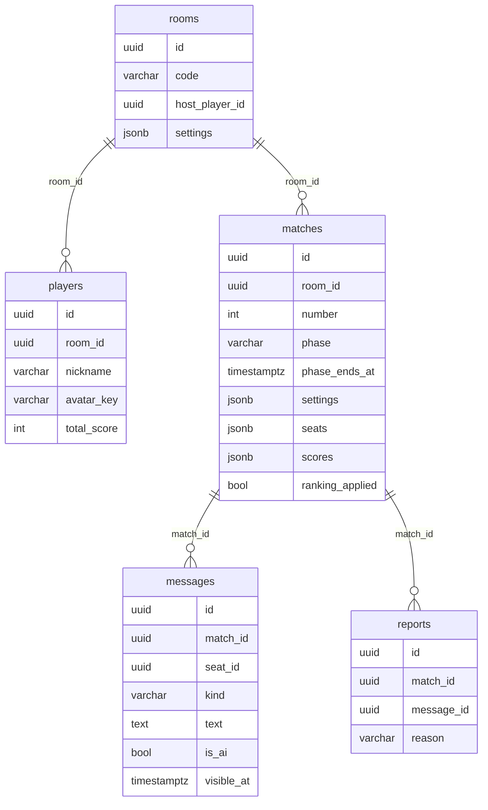
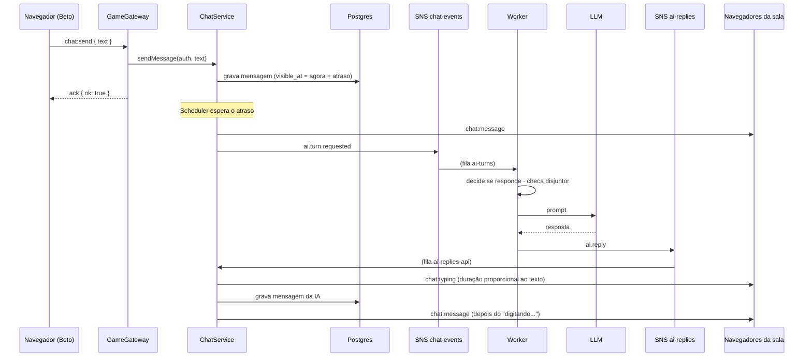
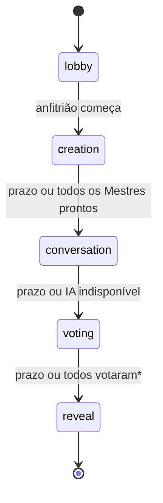

# Arquitetura

## Visão geral

Três processos: **web** (nginx com o build do React), **api** e **worker**. A api e o
worker são aplicações NestJS separadas, cada uma com seu Dockerfile, sua
configuração e suas migrações. Elas não chamam uma à outra: conversam só por
eventos no SNS/SQS.

## Módulos

### packages/shared

Contratos usados pelos três lados, sem dependências de runtime:

- `socket-events.ts`: eventos do WebSocket (cliente → servidor e servidor →
  cliente), tipados. Se a API e o front divergirem, o TypeScript avisa.
- `views.ts`: o que o servidor manda para cada jogador (`RoomStateView`,
  `MatchView`, `RevealView`...).
- `bus-events.ts`: eventos do SNS/SQS e o mapa tópico → filas.
- `room-settings.ts`: configurações da sala, valores padrão e saneamento.
- `moderation.ts`: lista de bloqueio com normalização (acentos, leetspeak, letras
  repetidas).

### packages/cloud

Infraestrutura AWS compartilhada pela api e pelo worker:

- `MessageBus` (interface) com `AwsMessageBus` (SNS para publicar, SQS com long
  polling para consumir) e `InMemoryMessageBus` (testes e modo processo único).
  `createMessageBus` escolhe pelo `MESSAGE_BUS`; no driver `memory`, a API e o
  worker do mesmo processo recebem a mesma instância
  ([HOSPEDAGEM.md](HOSPEDAGEM.md)).
- `loadSecrets`: Secrets Manager com fallback para variáveis de ambiente.
- `ApiKeyCipher`: AES-256-GCM para a chave própria do Mestre.

### apps/api

| Módulo | domain | application | infrastructure |
| --- | --- | --- | --- |
| rooms | `Room`, `Player`, código da sala, apelido | `RoomsService` (criar, entrar, avatar) | schemas, `RoomsController`, DTOs |
| game | `GameMatch` (agregado), máquina de estados, sorteio, regras do chat, pontuação | `MatchService`, `ChatService`, `RankingService`, `RoomPresenter`, `MessageDelivery`, `AiTurnPublisher` | `GameGateway`, `SocketRealtime`, consumidores de fila, schemas |
| moderation | `Report` | (usado pelo `ChatService`) | schema |
| auth | | `PlayerTokenService` (JWT) | `PlayerAuthGuard` |

Infraestrutura comum: `RoomTransaction` (lock por sala + unidade de trabalho),
`Scheduler` (timers), `ObjectStorage` (S3), filtro de erros e healthcheck.

### apps/worker

| Módulo | domain | application | infrastructure |
| --- | --- | --- | --- |
| ai-turn | decisão de responder, prompt, detecção de "saiu do personagem" | `AiTurnHandler` | provedores de LLM (Gemini, Ollama, Fake) |
| usage | disjuntor de orçamento, registros | `BudgetService`, `MatchStatsHandler`, `UsageRepository` (porta) | `PostgresUsageRepository`, schemas, `/health` e `/stats` |

### apps/web

- `lib/useGame.ts`: conexão Socket.IO, estado recebido, chat, "digitando..." e
  reconexão.
- `screens/`: uma tela por fase (`Lobby`, `CreationPhase`, `ChatPhase`,
  `RevealScreen`), escolhida em `RoomScreen` pela fase que o servidor manda.

## Dados

- Agregados se referenciam só por id (sem relações do ORM), e por isso não há
  chaves estrangeiras declaradas.
- Os lugares (`seats`) ficam em JSON dentro da partida: são lidos e gravados sempre
  junto com ela. Cada lugar guarda pseudônimo, avatar, papel (jogador ou Mestre),
  persona, voto e contadores.
- `messages.visible_at` é o momento em que a mensagem aparece para os outros (pode
  ser no futuro, por causa do atraso realista).
- O worker tem o schema `worker`: `daily_usage` (disjuntor), `match_usage` e
  `match_stats`.

## Eventos

| Tópico SNS | Evento | Fila SQS | Quem consome |
| --- | --- | --- | --- |
| `chat-events` | `ai.turn.requested` | `ai-turns` | worker |
| `ai-replies` | `ai.reply`, `ai.unavailable` | `ai-replies-api` | api |
| `match-events` | `match.finished` | `match-ranking` | api (ranking) |
| | | `match-stats` | worker (estatísticas) |

Todas as filas têm DLQ (`<fila>-dlq`) com `maxReceiveCount` 3. As assinaturas usam
"raw message delivery", então o corpo da mensagem SQS é o próprio evento JSON.

## Caminho de uma mensagem

## Fases da partida

\* Com o número de IAs secreto, a votação não encerra antes do prazo (contar quem
falta votar entregaria quantos Mestres existem).

As transições estão em `apps/api/src/modules/game/domain/match-state-machine.ts`; o
que acontece em cada uma, em `GameMatch.transitionTo`.
